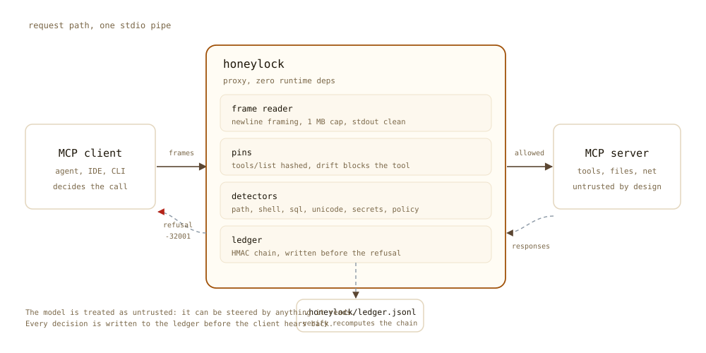

# Architecture



`honeylock` is a filter, not a platform. It sits on the stdio pipe between an MCP client and an MCP server, sees every JSON-RPC frame in both directions, and decides on each `tools/call` before it is forwarded.

## Components

| Component | File | Responsibility |
|---|---|---|
| Frame reader | `src/proxy.ts` | Splits byte streams into lines, enforces the size cap, keeps `stdout` clean |
| Router | `src/proxy.ts` | Unpacks batches, classifies messages, rewrites refusals as JSON-RPC errors |
| Detectors | `src/detectors.ts` | Six pure functions from `(tool, args)` to findings |
| Normalisers | `src/decode.ts` | Percent decoding, shell quoting, SQL comments, Unicode, base64/hex layers |
| Pipeline | `src/pipeline.ts` | Collects strings once, runs detectors, returns the worst verdict with timings |
| Pins | `src/lock.ts` | Hashes `tools/list` definitions, reports drift, gates changed tools |
| Ledger | `src/ledger.ts` | HMAC-chained JSONL, append and verify |
| Benchmark | `src/benchmark.ts` | Runs the vector corpus, measures per phase, prints the table |

## Data flow

1. The client writes a JSON-RPC frame to stdin.
2. The frame is split on newlines and capped at `--max-bytes` while streaming. Over-long frames are dropped and recorded.
3. If it is a batch, each item is classified separately; allowed items are re-packed into one batch.
4. A `tools/call` is checked twice: first against the pin state, then against the detectors.
5. `block` becomes an error response with code `-32001`. `review` is denied unless `--on-review allow` is set. `allow` is forwarded unchanged.
6. Every decision, and every pin event, is appended to the ledger before the client hears back.
7. Server responses are forwarded untouched, except `tools/list`, which is inspected to refresh the pin state.

## Invariants

These are the properties a change must not break:

1. **`stdout` carries only JSON-RPC frames.** One stray `console.log` corrupts the session.
2. **Fail closed.** Unknown state, oversized frames, invalid JSON-RPC and detector errors all refuse the call.
3. **Record before refusing.** A block without a ledger entry is a bug.
4. **Detectors are pure.** No network, no writes, and filesystem access only for `realpath` on paths that already exist.
5. **No runtime dependencies.** `scripts/check-deps.js` fails CI otherwise.
6. **Latency is measured, not asserted.** Any performance claim in the docs comes from `honeylock benchmark`.

## Trust boundaries

```
[ model ] --decides--> [ client ] --frames--> [ honeylock ] --frames--> [ server ]
     ^                                             |
     |                                             +--> ledger (local file, HMAC key)
     +----------- content the model reads <-------+
```

The model is on the untrusted side of the boundary in practice: it can be steered by anything it reads. That is why the checkpoint is here and not in the client.

`honeylock` cannot see the model's own output channel, so text exfiltration without a tool call is out of reach. This is stated in the README and in the threat model on purpose.

## Why a proxy and not a library

A library only protects the client that adopts it. A process boundary works with any client that can spawn a command, requires no code change in either the client or the server, and leaves an audit trail outside both.

The trade-off is that stdio proxying is a protocol problem, not an API problem: framing, batching, back-pressure and exit codes all have to be right. That is most of the code in `proxy.ts`, and why the test suite runs real processes rather than mocks.
